# NAAb — Stop AI Agents Before They Do Damage

[](https://github.com/b-macker/NAAb/actions/workflows/ci.yml)
[](https://github.com/b-macker/NAAb/actions/workflows/sanitizers.yml)
[](https://github.com/b-macker/NAAb/actions/workflows/codeql.yml)
[](https://opensource.org/licenses/MIT)
[](CONTRIBUTING.md)
[](https://github.com/b-macker/NAAb/discussions)

NAAb is a programming language with a governance engine built into its runtime. You write the rules in `govern.json`, and the engine enforces them while the program runs — including what the program does with the AI agents it talks to. A program that reads a secret, encodes it and sends it to a model is stopped at the send, **before the request leaves the process**:

```
$ GEMINI_API_KEY=placeholder ./build/naab-lang examples/quickstart/agent_task.naab
Error: Governance error: Behavioral sequence 'credential_exfiltration' blocked before execution: 'agent.send' would complete a dangerous 3-step pattern [HARD-MANDATORY]

  Rule: behavioral_sequences.credential_exfiltration

  Help:
  - This action would complete a known dangerous sequence.
  - The operation was blocked before execution.
```

The run exits with code 3. The key can be any value: the refusal comes first, so no request is made. No prompt engineering, and no scanning of logs after the fact.

---

## Quick Start

### Build

```bash
git clone --recursive https://github.com/b-macker/NAAb.git
cd NAAb
mkdir build && cd build
cmake ..
make naab-lang -j4
cd ..
```

Dependencies, and the compilers each polyglot language needs: [INSTALL.md](INSTALL.md).

### Run the example above

```bash
GEMINI_API_KEY=placeholder ./build/naab-lang examples/quickstart/agent_task.naab
```

The program, `examples/quickstart/agent_task.naab`:

```naab
// A program that does what a compromised or confused agent might: read a
// secret, encode it, send it to a model. govern.json beside this file
// declares that sequence dangerous, so the send is refused before any
// request leaves the process (exit 3).
//
//   GEMINI_API_KEY=placeholder ./build/naab-lang examples/quickstart/agent_task.naab
//
// The key can be any value: the refusal comes first, so nothing is sent.
use env
use crypto
use agent

main {
    // 1. read a secret (a demo value stands in when the variable is unset)
    let secret = env.get("API_SECRET_KEY") ?? "demo-secret"
    // 2. encode it
    let encoded = crypto.base64_encode(secret)
    // 3. send it to a model
    let h = agent.create("assistant")
    let reply = agent.send(h, encoded)
    print("sent: " + string(reply))
}
```

The policy beside it, `examples/quickstart/govern.json`:

```json
{
  "version": "5.0",
  "mode": "enforce",
  "security": { "sandbox_level": "elevated" },
  "behavioral_sequences": {
    "enabled": true,
    "patterns": [
      {
        "name": "credential_exfiltration",
        "sequence": ["env.get:*KEY*|*SECRET*|*TOKEN*", "encode|base64", "agent.send|http.post"],
        "level": "hard",
        "rationale": "Reading credentials then encoding and sending matches exfiltration."
      },
      {
        "name": "config_harvest",
        "sequence": ["file.read:*config*", "agent.send"],
        "level": "hard",
        "rationale": "Reading config files then sending content to an external agent."
      }
    ]
  },
  "agents": {
    "assistant": {
      "provider": "gemini",
      "model": "gemini-2.5-flash",
      "api_key_env": "GEMINI_API_KEY",
      "max_tokens": 256
    }
  }
}
```

Each step of a pattern names an event (`env.get`, `file.read`, `agent.send`, `http.post`, ...) and can match its detail with a glob after `:`; `|` separates alternatives. The engine tracks events across the whole run, with a configurable gap between steps, and refuses the step that would complete a pattern. Sequence detection is off until `behavioral_sequences.enabled` is true. Listing `patterns` replaces the 16 built-in ones, which are advisory unless you set `"default_pattern_enforcement": "declared"`; none of the built-in ones covers this chain. `sandbox_level: "elevated"` lets the program read the environment at all: at `standard`, the default under `enforce`, the sandbox refuses `env.get` before any pattern is reached.

### Start your own project

```bash
mkdir hello && cd hello
../build/naab-lang init        # writes naab.toml and a standard govern.json
```

```naab
// hello.naab
main {
    let name = "World"
    print("Hello, " + name + "!")
}
```

```bash
../build/naab-lang hello.naab      # run a file
../build/naab-lang                 # interactive REPL
```

NAAb looks for a `govern.json` in the program's directory and its parents, and refuses to run a program without one (exit 4). `naab-lang init --governance-preset relaxed|standard|strict|paranoid` picks how strict the generated file is. `--no-governance` waives the requirement, but a `govern.json` that is found still applies.

---

## How It Works

**Before the program runs**, every polyglot block and every function is checked against the policy: hallucinated APIs (`.push()` in Python), stubs shipped as finished code (`return True` validators), hardcoded secrets, SQL and shell injection, empty `catch` blocks, PII.

**While it runs**, the engine stands between the program and the outside world. Shell, network, filesystem and environment access go through capability gates. Taint tracking follows untrusted values (`env.get`, polyglot output) to sinks. Sequence detection watches for multi-step patterns like the one above. Context drift detection scores each agent turn.

**Every rule has a level:**

- **HARD:** blocks, and NAAb `try`/`catch` cannot catch it. The run exits with code 3.
- **SOFT:** blocks (exit 3) unless the run passes `--governance-override`.
- **ADVISORY:** warns and continues. With advisory escalation on, a repeated advisory becomes a HARD block.
- **DETECT:** blocks like HARD, but `try`/`catch` can catch it. Meant for test configurations.

**The program cannot rewrite its own policy.** `govern.json`, its signature and the trusted keys are protected paths: the program can neither read nor overwrite them. Sign the policy with Ed25519 and any later edit is an integrity block on the next run. A change to `govern.json` picked up during a run is accepted only if it tightens the rules (the ratchet).

```bash
mkdir -p keys
naab-lang --keygen ./keys/governance                          # writes keys/governance and keys/governance.pub
naab-lang --trust-key ./keys/governance.pub                   # trust the public key on this machine
naab-lang --signing-key ./keys/governance --sign-governance   # writes govern.json.sig
```

---

## What It Stops

| Threat | Example | Stopped by |
|---|---|---|
| Credential exfiltration | `env.get` of a secret → encode → `agent.send` | A sequence pattern; the send is refused before it is made |
| Config harvesting | `file.read("app_config.json")` → `agent.send` | A sequence pattern (`config_harvest` above) |
| Rewriting the policy | `file.read("govern.json")`, `file.write("govern.json", ...)` | Protected paths: a HARD block |
| Hallucinated APIs | `.push()` in a Python block, `import fake_ai_toolkit` | Pre-run checks |
| Stubs and swallowed errors | `fn validate() { return true }`, an empty `catch (e) { }` | Pre-run checks |
| Hardcoded secrets | an `sk-proj-...` key in a block | `code_quality.no_secrets` |
| Tainted data reaching a shell | `env.get(...)` passed into a `<<shell>>` block | Taint tracking |
| Capability abuse | a shell command, a socket, a file write | `capabilities.*`; `shell.enabled: false` refuses every language that runs as a separate process |
| Secrets in agent traffic | a key in a prompt, a reply, a tool argument or result | `code_quality.no_secrets` (off by default; when on, a hit ends the run) |
| Agent drift | repetition, circular actions, mandate drift, failed validations | Context drift detection, 23 signals; output admissibility can quarantine or block the reply |

The demo runs six of these mistakes, each blocked for its own reason, and one clean program:

<p align="center">
  
</p>

Run it yourself: `bash demo/governance_demo.sh` | Record: `bash demo/governance_demo.sh --record`

### What it does not stop

Path rules reach NAAb's standard library and the embedded Python executor. They do not reach languages that run as a separate process (shell, Ruby, Node, PHP, ...) while shell is enabled; `capabilities.shell.enabled: false` refuses those languages outright. NAAb prints the advisory `CONTRA-013` for any config with path rules, unless the sandbox is `restricted`. The [protection map](docs/protection-map.md) records, for each language and forbidden action, which layer stops it: 39 of its 323 cells are open when run as root (36 as an ordinary user), all but four of the open and text-only cells in configurations where the project enables shell. See also the [security model](docs/SECURITY.md).

---

## Configuration

A `govern.json` with the common checks:

```json
{
  "version": "5.0",
  "mode": "enforce",

  "languages": {
    "allowed": ["python", "javascript", "go"],
    "blocked": ["php"]
  },

  "code_quality": {
    "no_secrets": { "level": "hard" },
    "no_sql_injection": { "level": "hard" },
    "no_oversimplification": { "level": "hard" },
    "no_incomplete_logic": { "level": "soft" },
    "no_hallucinated_apis": { "level": "soft" }
  },

  "restrictions": {
    "code_injection": { "level": "hard" },
    "shell_injection": { "level": "hard" }
  },

  "limits": {
    "code": { "max_lines_per_block": 200 },
    "timeout": { "global": 30 }
  }
}
```

Every setting, with its default and a comment: [`govern-template.json`](govern-template.json). [Build one interactively](https://b-macker.github.io/NAAb/governance.html), or read the [full governance reference (Chapter 21)](docs/book/chapter21.md).

Your own regex rules:

```json
{
  "custom_rules": [
    {
      "id": "no-print-debugging",
      "name": "no_print_debugging",
      "pattern": "console\\.log|print\\(.*debug",
      "message": "Remove debug print statements before committing",
      "level": "soft"
    }
  ]
}
```

With `project_context.enabled`, NAAb also takes rules from files the project already has, without overriding `govern.json`: LLM instruction files (`CLAUDE.md`, `.cursorrules`, `.github/copilot-instructions.md`), linter configs (`.editorconfig`, `.eslintrc`, `.prettierrc`) and manifests (`package.json`, `Cargo.toml`, `go.mod`, `pyproject.toml`).

### CI

```bash
# GitHub Code Scanning (SARIF)
naab-lang app.naab --governance-sarif results.sarif

# Jenkins / GitLab CI (JUnit XML)
naab-lang app.naab --governance-junit results.xml

# Custom tooling (JSON)
naab-lang app.naab --governance-report results.json
```

The report flags go after the file name. `naab-gov lint app.naab` checks a file without running it.

---

## Features

### Agent governance

Each agent the program talks to gets its own role in `govern.json`: model, key, limits and permissions.

```json
{
  "agents": {
    "analyzer": {
      "provider": "gemini",
      "model": "gemini-2.5-flash",
      "api_key_env": "GEMINI_API_KEY",
      "system_prompt": "You are a code analyzer.",
      "max_turns": 20,
      "max_tokens": 4096,
      "allowed_languages": ["python", "javascript"],
      "allowed_actions": ["AGENT_SEND", "FS_READ"],
      "standing_lease_turns": 10,
      "output_contract": {
        "format": "json",
        "required_fields": ["severity", "category"],
        "regex_checks": { "severity": "^(low|medium|high|critical)$" }
      }
    }
  }
}
```

```bash
naab-lang app.naab --agent-id analyzer                          # run as that role
naab-lang app.naab --agent-id analyzer --governance-dashboard   # and print the governance summary
```

- **Limits and budgets:** per-agent turns and tokens, and run-wide caps on calls, tokens and time (`agent_dispatch.hard_stop`) that count every provider call the agent module makes.
- **Leases and challenges:** a standing lease limits how long an agent stays authorized; an expired lease, or rising scrutiny, brings a step-up challenge.
- **Output checks:** output contracts check a reply's structure; output admissibility quarantines, attests or blocks a reply whose coherence is too low.
- **Propose / commit:** `agent.propose()` generates candidate replies without changing any state, and `agent.commit()` runs the full checks on the one you pick.
- **Tools:** `agent.register_tool()` runs a governed tool loop. A tool must be both listed in `govern.json` and registered, and its arguments and results are scanned.
- **Resilience:** key rotation and model fallback (`api_key_env` and `model` accept arrays).

### Live guidance

`guidance.sources` lists where the project's own knowledge lives: markdown documents, a SQLite database, an `https://` URL, a command or an MCP server. When governance observes something (an agent's first send, a drift signal, a failed validation, a violation), the matching section goes into the agent's next request or under the message shown in the terminal. The program may not write a source, and the text is checked for secrets before delivery. See [docs/plan-live-guidance.md](docs/plan-live-guidance.md).

### MCP server

`naab-lang mcp` serves governed execution over the Model Context Protocol on stdio, with the tools `naab_lease`, `naab_propose`, `naab_commit`, `naab_run` and `naab_verify_attestation`. No user code runs in the server process: every call runs in a fresh worker. It is not available on Windows yet. See [docs/plan-mcp-service.md](docs/plan-mcp-service.md).

### Polyglot blocks

One file can mix languages; NAAb variables pass into a block and its result comes back as a value. Every block is checked against the policy before it runs.

**Supported languages:** Python · JavaScript · TypeScript · Rust · C++ · Go · C# · Ruby · PHP · Shell · Nim · Zig · Julia · SQL

```naab
main {
    let numbers = [10, 20, 30, 40, 50]

    // Python: statistical analysis
    let stats = <<python[numbers]
import statistics
result = {
    "mean": statistics.mean(numbers),
    "stdev": statistics.stdev(numbers)
}
str(result)
>>

    // JavaScript: format as HTML
    let html = <<javascript
const data = "Stats: mean=30, stdev=15.81";
`<div class="result">${data}</div>`;
>>

    print(stats)
    print(html)
}
```

A language runs only if `govern.json` allows it and its compiler or interpreter is installed (the standard `init` profile allows Python and Shell). More, including SQL blocks and persistent runtimes: the [language tour](docs/language-tour.md#polyglot-blocks).

### Tooling

- **`naab-gov`:** a standalone governance CLI (`make naab-gov`) for linting files and working with `govern.json` without running a program.
- **`naab-lsp`:** a Language Server (`make naab-lsp`) that powers the [VS Code extension](vscode-naab/).
- **Governance C API:** embed the engine in other agent frameworks through `bindings/` (C#, Go, Java, Python, Rust).
- **Telemetry:** JSONL events with a tamper-evident hash chain, forwarding to a webhook or SIEM, and SARIF, JUnit and JSON reports.

---

## The Language

NAAb itself is small and familiar: functions, closures, pattern matching, generators, async/await, structs and interfaces, f-strings, a pipeline operator, and a 25-module standard library. It accepts several keyword styles (`fn`, `function`, `func`, `def`), and its error messages name the NAAb form of a mistake carried over from another language.

```naab
fn label(point) {
    return match point {
        [0, 0] => "origin"
        [x, 0] => f"on the x-axis at {x}"
        [x, y] => f"point ({x}, {y})"
    }
}

main {
    let points = [[0, 0], [3, 0], [3, 4]]
    for p in points {
        print(label(p))
    }
    print(label([3, 4]))  // "point (3, 4)"
}
```

Every feature, with examples that run in CI: the [language tour](docs/language-tour.md).

---

## NAAb Ecosystem

Three tools built with NAAb — code governance, performance optimization, and data security:

| Project | Purpose | Key Features |
|---------|---------|--------------|
| **[NAAb BOLO](https://github.com/b-macker/naab-bolo)** | Code governance & validation | 50+ checks, SARIF reports, AI drift detection |
| **[NAAb Pivot](https://github.com/b-macker/naab-pivot)** | Code evolution & optimization | 3-60x speedups, proven correctness, 8 languages |
| **[NAAb Passage](https://github.com/b-macker/naab-passage)** | Data gateway & PII protection | Zero leakage, sovereign architecture, HIPAA/GDPR |

Each project's own README has its commands and details.

---

## Architecture

```
Source Code (.naab)
    |
  Lexer ──> Tokens
    |
  Parser ──> AST (recursive descent)
    |
  Governance Engine ──> Policy checks (govern.json)
    |
  ┌─────────────────────────────────────────────┐
  │  Compiler ──> Bytecode ──> VM (default)     │
  │       — OR —                                │
  │  Interpreter (visitor pattern, --tree-walk)  │
  └─────────────────────────────────────────────┘
    |
  ├── Native execution (NAAb code)
  ├── Python executor (embedded CPython; a subprocess when pybind11 is absent)
  ├── JavaScript executor (QuickJS, in-process)
  ├── SQL executor (SQLite, in-process)
  ├── Go/Rust/C++/C#/Nim/Zig/Julia executors (compile & run)
  ├── Ruby/PHP/TypeScript executors (interpreted)
  └── Shell executor (subprocess)
```

C++17, built with Abseil, fmt, spdlog, nlohmann/json, QuickJS and SQLite. The bytecode VM is the default engine; `--tree-walk` selects the tree-walking interpreter.

---

## Contributing

Contributions are welcome! See [CONTRIBUTING.md](CONTRIBUTING.md) for build instructions and guidelines.

### Areas for Contribution
- VM optimization (`src/vm/`)
- Agent governance extensions (`src/runtime/governance_*.cpp`, `src/stdlib/agent_impl.cpp`)
- New standard library modules
- Documentation and tutorials
- IDE integrations (Vim, Emacs, IntelliJ, VS Code)
- Package registry (centralized module hosting)

---

## License

MIT License - see [LICENSE](LICENSE) for details.

**Brandon Mackert** - [@b-macker](https://github.com/b-macker)
